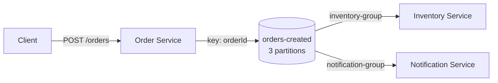

# Kafka Pub/Sub – E-commerce Order Processing

A small TypeScript/Node.js example of event-driven order processing. The Order Service publishes one `ORDER_CREATED` event; Inventory and Notification consume it independently through separate Kafka consumer groups.

## Architecture



Services do not call one another. Each consumer group receives its own copy of every event. The Kafka broker is a single-node KRaft broker intended for local development; topic replication factor is one.

## Requirements and installation

- Node.js 20+
- Docker with Docker Compose

From the project directory:

```bash
npm install
Copy-Item .env.example .env
docker compose up -d
npm run build
```

`Copy-Item` is the PowerShell command; on other shells, copy `.env.example` to `.env`. Defaults connect the apps to `localhost:9092`. Kafka is configured to create topics automatically, and each service also ensures `orders-created` exists with three partitions and replication factor one at startup.

Logs use Pino JSON in production. In development, Pino Pretty formats the same structured fields for readability. Set `LOG_LEVEL` to `debug`, `info`, `warn`, or `error` in `.env` to adjust verbosity (default: `info`).

## Start the services

Run each command in its own terminal:

```bash
npm run dev:order
npm run dev:inventory
npm run dev:notification
```

The apps can also be started after `npm run build` using `npm run start:order`, `npm run start:inventory`, and `npm run start:notification`.

## API

`POST http://localhost:3000/orders` accepts:

```json
{
  "userId": "user-101",
  "items": [
    { "productId": "product-101", "quantity": 2 }
  ],
  "totalAmount": 1500
}
```

Example request (PowerShell):

```powershell
curl.exe -X POST http://localhost:3000/orders `
  -H "Content-Type: application/json" `
  -d '{"userId":"user-101","items":[{"productId":"product-101","quantity":2}],"totalAmount":1500}'
```

Successful requests return `201 Created` with `{ "orderId": "...", "status": "published" }`. Invalid requests return `400`; Kafka publishing failures return `503`. `GET /health` checks that the Order Service is running with its Kafka producer connected.

The published event has this shape (IDs and timestamp are generated):

```json
{
  "eventId": "event-101",
  "eventType": "ORDER_CREATED",
  "orderId": "order-101",
  "userId": "user-101",
  "items": [{ "productId": "product-101", "quantity": 2 }],
  "totalAmount": 1500,
  "createdAt": "2026-01-01T00:00:00.000Z"
}
```

## Kafka behavior demonstrated

- **Topic and partitions:** `orders-created` has three partitions. Kafka selects a partition for an order using its message key.
- **Message key:** `orderId` is the key, so all events with the same order ID are routed consistently to one partition.
- **Consumer groups:** Inventory uses `inventory-group`; Notification uses `notification-group`. A consumer group distributes partitions among its own members. Different groups each read the topic independently, so both services receive each event.
- **Offsets and processing:** Consumers disable automatic commits. They call their handler and commit offset `message.offset + 1` only after it succeeds. A handler or commit failure leaves the offset uncommitted, so Kafka can deliver that message again after retry/restart. This is at-least-once delivery: handlers that perform real side effects should be idempotent. A crash after a side effect but before committing can cause a duplicate.
- **Starting position:** New groups start from the earliest retained event. Existing groups resume from their committed offsets. The Kafka topic retains events according to the broker's default retention policy.
- **Error handling:** Processing errors are logged and surfaced to KafkaJS; the failed offset is not acknowledged. Fix the issue and restart the consumer to retry. Invalid messages similarly remain uncommitted and require remediation rather than being silently skipped.
- **Consumer process lifetime:** `consumer.run()` starts the background Kafka fetch loop and resolves after startup; it is not a promise that stays pending until the service is stopped. The apps keep running until `SIGINT`/`SIGTERM`, then stop and disconnect their consumer gracefully.

## Verify independent consumption and restart recovery

1. Start Kafka with `docker compose up -d` and wait for the broker to become ready.
2. Start the Order, Inventory, and Notification services in separate terminals.
3. Submit the sample `POST /orders` request.
4. Confirm the returned order ID appears in both consumer logs. Inventory logs the reserved product/quantity; Notification logs the user, order, and `sent` status.
5. Stop only the Notification Service (Ctrl+C), submit another order, then restart it with `npm run dev:notification`.
6. Notification resumes its own group's committed position and logs the order published while it was down. Inventory continues processing both orders throughout. Each group maintains independent offsets.

### Following an order in logs

Follow the generated `orderId` or `eventId` across the three terminal windows:

1. Order Service logs request acceptance, then `Publishing order event` and `Order event published` with the topic, message key, partition, and broker offset.
2. Each consumer independently logs `Order event received` with its consumer group, topic, partition, and offset.
3. Inventory logs the stock check and reserved items; Notification logs the recipient and sent status.
4. Each consumer logs `Order event processed and offset committed` only after its handler succeeds. Processing failures are logged with Kafka coordinates and are rethrown, leaving the offset uncommitted.

Pino JSON output includes a `service` name, message, timestamp, and structured fields such as `orderId`, `eventId`, and `consumerGroup`. Pretty output is enabled outside production; set `NODE_ENV=production` for newline-delimited JSON.

To inspect topic configuration using the Kafka container:

```bash
docker exec -it $(docker ps -q --filter "ancestor=apache/kafka:3.9.0") \
  /opt/kafka/bin/kafka-topics.sh --bootstrap-server localhost:9092 --describe --topic orders-created
```

## Tests

```bash
npm test
npx jest tests/orders-api.test.ts --runInBand
npm run build
```

The first command runs all Jest tests; the second runs only the `POST /orders` API tests. API tests use Supertest with a mocked Kafka producer, so no broker or running service is needed. They verify the `201` response and published event, invalid-request handling, and Kafka failure handling. The remaining tests cover event validation, keyed publishing, independent consumer groups, and post-processing offset commits. Verify end-to-end delivery separately with the local broker and the restart procedure above.
